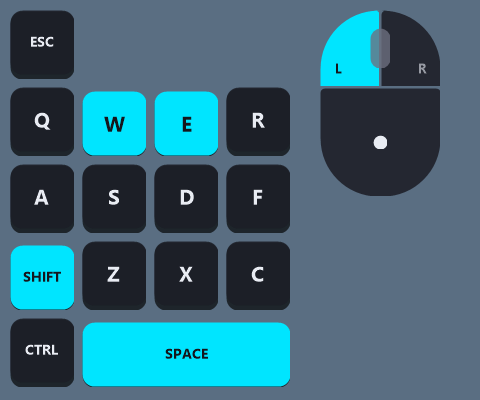

# Input Overlay: WASD + мышь (минимальный пресет)

Простой пресет для плагина [Input Overlay](https://github.com/univrsal/input-overlay) в OBS. Только нужные клавиши и мышка, ничего лишнего. Удобно, чтобы на записи или стриме было видно, что нажимает тестировщик или игрок.



**Клавиатура:** `Esc` · `Q W E R` · `A S D F` · `Shift Z X C` · `Ctrl` · `Space`
**Мышь:** левая и правая кнопки, колесо (подсвечивается при нажатии и прокрутке), точка движения.
Подсветка нажатия цвета циан.

## Что нужно

- OBS Studio 33+
- Input Overlay **5.1.1 или новее** ([релизы](https://github.com/univrsal/input-overlay/releases)). Старые версии (5.0.x) не загружаются в OBS 33. Для Windows берите `input-overlay-X.Y.Z-windows-x64-Installer.exe`.

## Установка (1 минута)

1. Скачайте этот репозиторий: **Code → Download ZIP** или архив из [Releases](../../releases). Распакуйте его в любую папку.
2. В OBS добавьте источник **Input Overlay**, назовите его, например, «Клавиатура».
   - Overlay image file: `keyboard/keys.png`
   - Overlay config file: `keyboard/keys.json`
3. Добавьте ещё один **Input Overlay** («Мышь»).
   - Overlay image file: `mouse/mouse.png`
   - Overlay config file: `mouse/mouse.json`
4. Расставьте оба источника на сцене как удобно.

Включать websocket-сервер и что-то ещё настраивать не нужно.

## Другой цвет подсветки

Пресеты генерируются скриптом. Чтобы перекрасить подсветку (Windows, PowerShell), запустите в папке репозитория:

```powershell
powershell -ExecutionPolicy Bypass -File tools\make-presets.ps1 -Accent "#FF4FA3"
```

Файлы в `keyboard/` и `mouse/` перезапишутся. После этого обновите источники в OBS.

## Если не работает

- **Источник пустой или серый.** Проверьте версию Input Overlay (нужна 5.1.1+). В логе OBS (Справка → Файлы журнала) не должно быть строки `input-overlay.dll not loaded`.
- **Не реагирует на нажатия в игре.** Некоторые игры перехватывают ввод. Обычно помогает запустить OBS от имени администратора.
- **Подсвечиваются только левые Shift и Ctrl.** Так задумано. Если нужны правые, добавьте в `keys.json` элементы с кодами `145` (R Shift) и `147` (R Ctrl).

---

### English

Minimal preset for the OBS [Input Overlay](https://github.com/univrsal/input-overlay) plugin (5.1.1+, OBS 33+). Keyboard: Esc, QWER, ASDF, Shift ZXC, Ctrl, Space. Mouse: L/R buttons, wheel, movement dot. Cyan highlight.
Add two *Input Overlay* sources: `keyboard/keys.png` + `keyboard/keys.json` and `mouse/mouse.png` + `mouse/mouse.json`. To change the highlight color, run `tools/make-presets.ps1 -Accent "#RRGGBB"`.

## License

MIT
